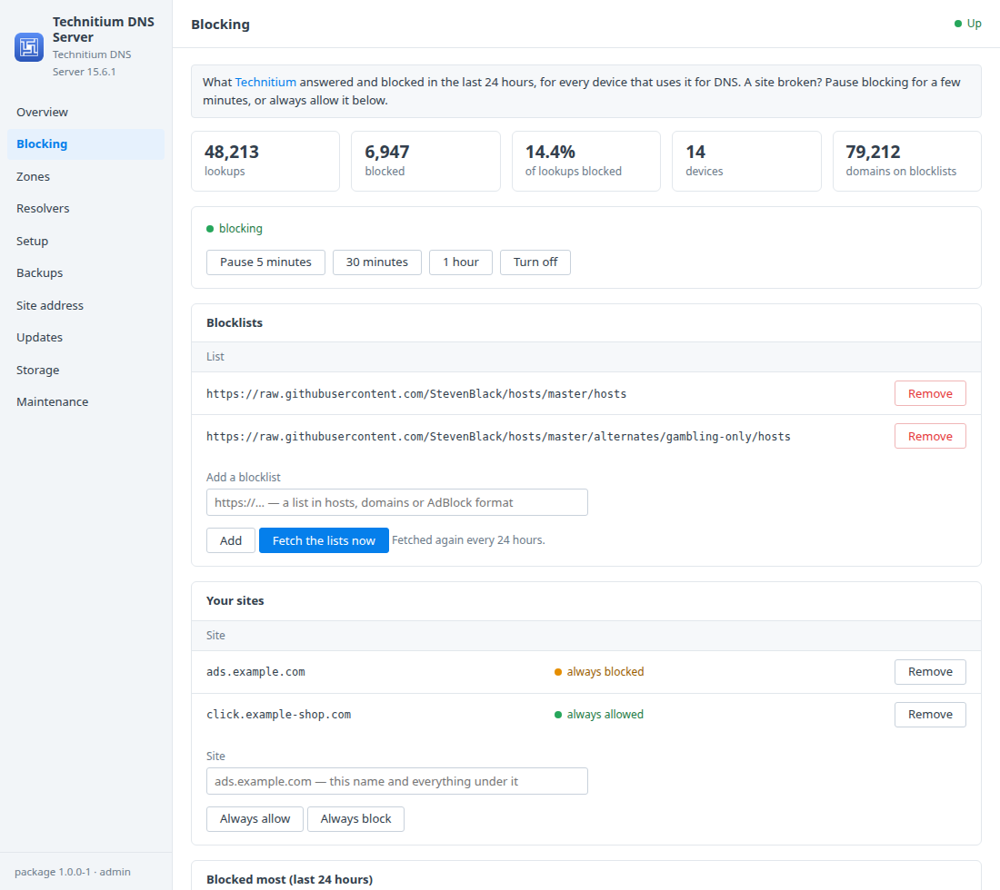
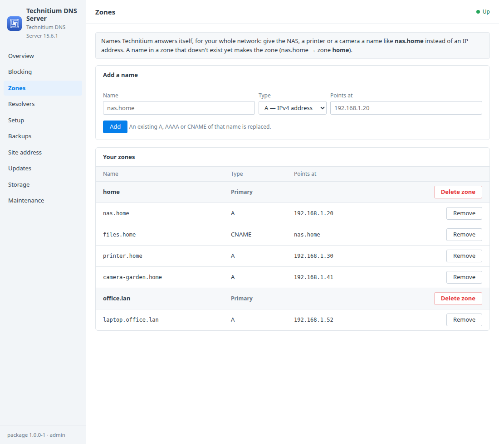
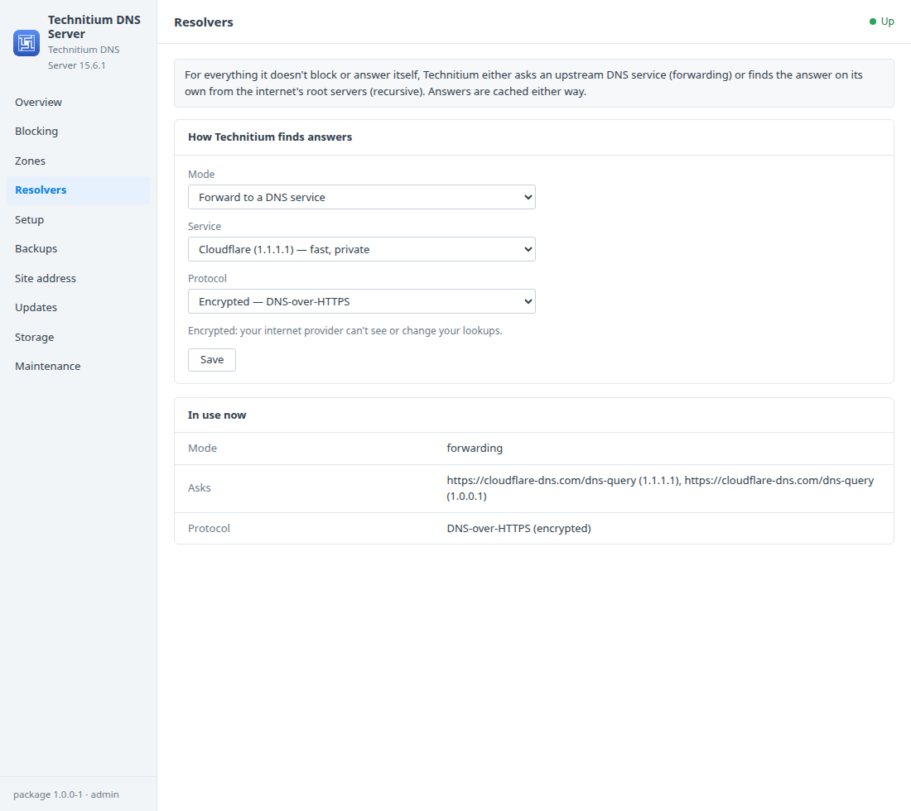
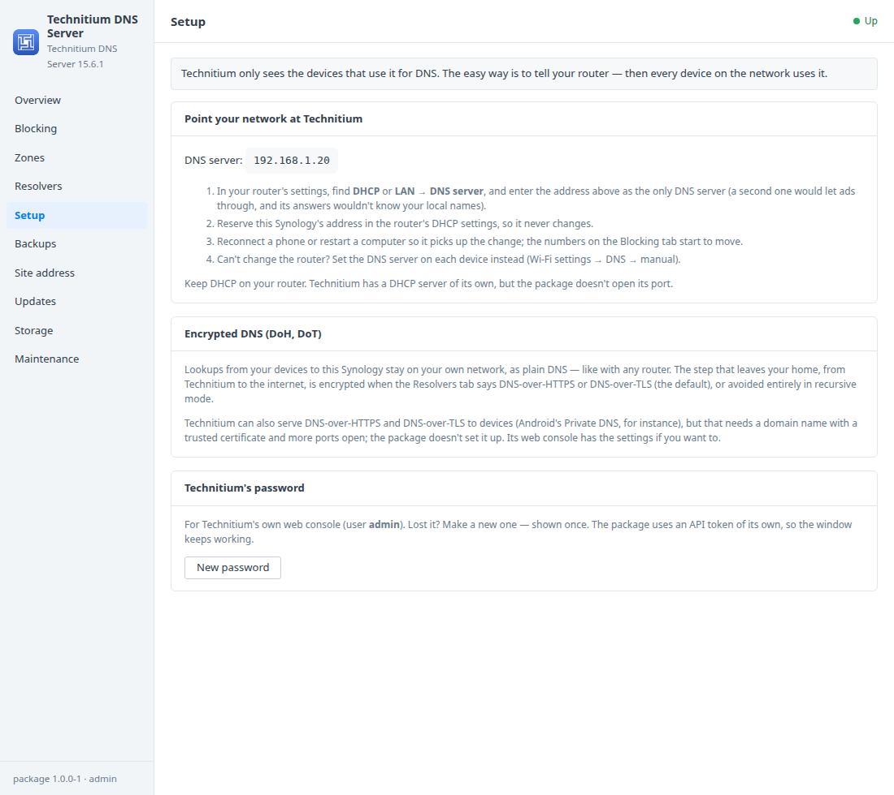

# Technitium DNS Server for Synology DSM

A DSM 7 package that installs [Technitium DNS Server](https://technitium.com/dns/)
in Container Manager. Technitium is a full DNS server for your network: it
blocks ads and trackers for every device, answers names you give your own
devices (`nas.home` instead of an IP address), and can encrypt lookups on their
way to the internet. A DSM window adds:
- blocking on and off, pausing, blocklists, and sites you always allow or block;
- local names (zones and records);
- the upstream DNS: forwarding, encrypted or not, or recursive;
- how to point your router at it;
- the password, HTTPS, backups and updates.

Built on the [DSM app chassis](https://github.com/tombruton87/dsm-app-chassis).

## Download

### **[⬇ Download technitium.spk](https://github.com/tombruton87/technitium-dsm/releases/latest/download/technitium.spk)**

[](https://github.com/tombruton87/technitium-dsm/releases/latest)

That link always gives the newest version. Older ones are on the
[Releases](https://github.com/tombruton87/technitium-dsm/releases) page.

Install: Package Center → Manual Install → the `.spk` (DSM 7.2.1+; Container
Manager is installed first if missing). The wizard asks for the NAS's address,
a port for Technitium's web console (5380 by default), a time zone, the DNS
port and HTTPS. The admin password is made at the first start and shown once
in the window.

**Port 53 on the Synology's LAN address must be free.** Routers and devices
only ask DNS servers on port 53. Technitium listens there on the NAS's LAN
address only (the one the wizard found), not on every address: many Synology
models keep `127.0.0.1:53` for DSM itself, and a package asking for all
addresses would clash with it. What does get in the way is DSM's **DNS
Server** package, Synology Directory Server, or another container publishing
port 53. Before starting, the package checks TCP and UDP on that address; if
something holds it, Technitium doesn't start and the log names what's there
and what to do, rather than retrying.

**Network.** By default Technitium runs on the NAS's own network, so its logs
and statistics show each device's address. It answers DNS on the LAN address
only, and its console is on the package's port. The Site address tab can switch
it to Docker's network instead, where every device shows up as Docker's
gateway; switching makes the container again, with DNS away for a few seconds.
On the NAS's own network the package's HTTPS for the console is off (DSM's
reverse proxy can add it).

Then point your network at it. In your router's DHCP/LAN settings, set the DNS
server to the Synology's address, as the only DNS server. The Setup tab walks
you through it.

## What the DSM window adds

- **Blocking**
  - Lookups and blocked lookups in the last 24 hours, the share blocked,
    devices, and domains on the blocklists.
  - **Pause** for 5 minutes, 30 minutes or an hour (it comes back by itself),
    or turn blocking off and on.
  - The blocklists: add one by address, remove one, **fetch the lists now**.
    The package starts with Steven Black's unified hosts list.
  - **Your sites:** always allow or always block a site (and everything under
    it).
  - The sites blocked most.
- **Zones**
  - Give the NAS, a printer or a camera a name: `nas.home → 192.168.1.20`. A,
    AAAA and CNAME records; the zone (`home`) is made for you.
  - Every zone and its names, with remove and delete.
- **Resolvers**
  - Forward to Cloudflare, Quad9 (which also blocks known malware), Google, or
    your own servers.
  - Encrypted (DNS-over-HTTPS, the default, or DNS-over-TLS) or plain.
  - Or **recursive**: Technitium finds answers itself from the root servers.
- **Setup**
  - The DNS server address for your router, step by step, and DHCP advice.
  - What encrypted DNS covers here (DoH and DoT).
  - **New password** for Technitium's console (shown once).
- **Site address** — HTTPS for the web console, with DSM's certificate (the
  system default; renewals are picked up daily) or a self-signed one. DNS
  itself is unaffected.
- **Backups, updates, storage, maintenance**
  - Backups hold Technitium's whole config folder: settings, zones,
    blocklists, your sites, users and statistics. They run nightly or on
    demand, with restore.
  - Technitium is stopped cleanly for the few seconds of the copy (see How it
    works).
  - **Updates:** the image is pinned to a tested release. When a newer one is
    on Docker Hub, the Updates tab offers it: a backup first, then the new
    image, and the old image is removed (only that one).
  - A newer package from inside DSM, a redacted support report, the logs, and
    removing Technitium with everything in it.

## Screenshots

| | |
|---|---|
|  |  |
|  |  |

## How it works

Technitium (`technitium/dns-server`, pinned) runs as one container. DNS is
published on port 53 (TCP and UDP) on the LAN address and its web console on the package's port.
Its config folder is the `technitium_config` volume.

The first start:
1. The package puts a throwaway password in the config folder. Technitium
   reads it only when it has no config yet.
2. The package signs in with it once and makes itself an API token, kept in
   the root-only settings file.
3. It sets your password (shown once, never stored) and deletes the throwaway.

Everything after goes through Technitium's own HTTP API with that token.

Technitium keeps users, tokens and zone permissions in memory and writes them
to disk only when it starts or stops cleanly. A copy of the live folder (its
own backup file included) can miss a new zone's permissions, and Technitium
then won't start from it. So backups stop it cleanly, copy the folder and
start it again, which takes a few seconds without DNS.

## Layout

```
chassis/          the DSM app chassis (git submodule)
package.conf      name, title, services, volumes, images, port, texts
app/compose.yaml  Technitium DNS Server
setup/app.sh      the hooks: first admin, port 53, blocking, lists, zones, resolvers, HTTPS, backups, updates
ui/               Blocking, Zones, Resolvers and Setup tabs; CGI validation
wizard/           the Technitium page of the install wizard (warns when port 53 is taken)
tests/            steps for the chassis harness (real lookups: blocked, allowed, paused, local names, forwarding)
```

Test on any Linux box with Docker:

```bash
chassis/tests/e2e.sh . up
E2E_PART=1 chassis/tests/e2e.sh . act   # blocking, lists, zones, backup and restore
E2E_PART=2 chassis/tests/e2e.sh . act   # resolvers, password, HTTPS, updates
```

The tests use DNS on port 1054, because a desktop's own resolver usually has
53.

Release: bump `VERSION`, add the changes to `CHANGELOG.md`, build, then attach
the package twice, under its versioned name and as `technitium.spk`:

```bash
cp dist/technitium-X.Y.Z-1.spk /tmp/technitium.spk
gh release create vX.Y.Z dist/technitium-X.Y.Z-1.spk /tmp/technitium.spk
```

Build: `chassis/build.sh . N`.

## Credits

The icon is Technitium's own mark on a blue DSM-style tile. Technitium DNS
Server is made by Technitium and is GPL-3.0 licensed. This package is not
affiliated with Technitium or Synology.
